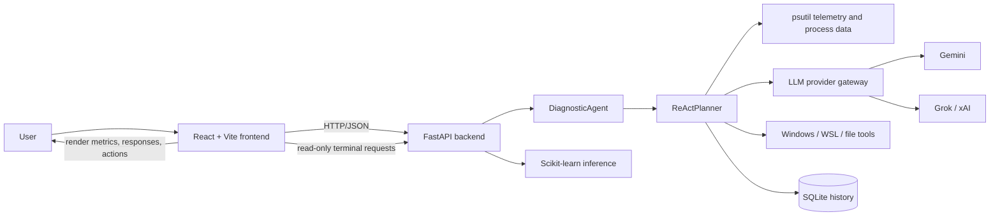

# KernelSense Project Guide

This guide explains the runnable KernelSense application, its design, current capabilities, setup, and limitations. It is intended as a handoff for a teammate and as a fact-checked starting point for a research paper.

> **Scope:** The primary runnable application is in [`2.0/`](./2.0/). The repository also contains other top-level folders; the root launcher delegates to the `2.0` application. This guide describes that application, not every file in the repository.

## 1. Project at a glance

**KernelSense** is a local web application for monitoring a computer, exploring processes and system information, and asking an AI assistant for operational help. It combines:

- A React dashboard and assistant interface.
- A Python/FastAPI backend that reads host telemetry through `psutil`.
- Scikit-learn models for telemetry anomaly scoring and system-log text classification.
- Gemini and xAI Grok cloud-provider options with explicit model selection.
- Local SQLite storage for assistant history.
- Windows host telemetry and System/Application event-log access, plus optional commands routed to Ubuntu under WSL.

The current implementation is best described as a **Windows-hosted system-monitoring and AI-operations prototype with optional WSL integration**. The frontend displays live backend values and no longer supplies mock telemetry. The app is not an eBPF agent or an autonomous kernel-level self-healing system.

### Short explanation for a teammate

> KernelSense shows host system metrics in a web dashboard and lets a user ask an assistant for explanations or proposed actions. The backend handles supported common requests locally first and sends unrecognized requests to the selected AI provider for a compact response or command proposal. File searches, desktop launches, and shell commands are presented as actions; command proposals include a risk assessment and require explicit user approval.

## 2. Goals and user-facing features

The codebase is designed to bring monitoring, diagnosis, and a few common operating-system tasks into one interface:

1. **System dashboard:** OS/build, CPU, memory, storage, network, uptime, and a calculated health score from the backend host.
2. **Assistant:** Free-form questions, system diagnosis, file search, local directory listing, application or URL launch requests, and selected Linux/OS command requests.
3. **Processes:** List running processes and request process termination.
4. **Storage:** Display disk and partition information.
5. **System health:** Show a weighted health score and category-level explanations.
6. **Logs/events:** Display live Windows System and Application event-log entries and filter by severity, source, or text.
7. **History:** Review persisted assistant queries and summaries.
8. **Command review:** Show proposed commands with Execute/Reject controls.
9. **Voice input:** Record a prompt in the browser and transcribe it with the local Whisper small model. The transcript remains editable and is not automatically submitted; the model downloads on first use, while audio stays local and is deleted after transcription.
10. **Read-only terminal:** Browse folders and view selected Windows system information through a restricted local command panel.

The frontend routes are defined in [`2.0/frontend/src/App.jsx`](./2.0/frontend/src/App.jsx); the individual pages are in [`2.0/frontend/src/pages/`](./2.0/frontend/src/pages/).

## 3. Architecture and request flow



### Main components

| Layer | Implementation | Responsibility |
|---|---|---|
| Web UI | React 19, Vite, React Router, Axios, Recharts | Dashboard, assistant chat, system pages, and API calls. |
| API | FastAPI, Pydantic, Uvicorn | Request validation and REST endpoints. Main entry point: [`2.0/backend/main.py`](./2.0/backend/main.py). |
| Assistant orchestration | [`core/ai_agent.py`](./2.0/backend/core/ai_agent.py), [`ai/planner.py`](./2.0/backend/ai/planner.py) | Handles recognized common requests locally; forwards unrecognized requests to an AI provider and creates UI responses. |
| LLM gateway | [`ai/llm_provider.py`](./2.0/backend/ai/llm_provider.py) | Uses a compact JSON prompt and routes only to the selected Gemini or Grok provider/model. |
| Telemetry and processes | [`core/live_telemetry.py`](./2.0/backend/core/live_telemetry.py), [`core/process_engine.py`](./2.0/backend/core/process_engine.py) | Reads host metrics and process information through `psutil`. |
| ML | [`core/ml_inference.py`](./2.0/backend/core/ml_inference.py) | Loads serialized models and runs telemetry and log predictions. |
| Operations | [`core/command_safety.py`](./2.0/backend/core/command_safety.py), [`core/file_finder.py`](./2.0/backend/core/file_finder.py), [`windows/apps.py`](./2.0/backend/windows/apps.py), [`ubuntu/bridge.py`](./2.0/backend/ubuntu/bridge.py) | Command screening, local file search, Windows app integration, and WSL command launching. |
| Persistence | [`core/database.py`](./2.0/backend/core/database.py) | Stores assistant history in SQLite. |

### Assistant request lifecycle

1. The user selects Gemini or Grok and submits a question in the Assistant page.
2. The browser sends the query, selected provider, optional model, and optional key to the local `/ask` endpoint.
3. The backend handles supported local requests first, including file search, known application/site actions, and explicit file creation.
4. Only unrecognized requests go to the selected provider. Likely system-performance questions include a small telemetry summary.
5. The model returns compact JSON with a response or at most one Windows command proposal and a risk assessment.
6. Only the selected provider is called. If it does not respond, the planner returns an offline telemetry response that identifies the selected provider as unavailable.
7. The UI renders the answer and any command with its AI and local risk assessments. Commands are never run automatically; the user must choose Execute or Reject, then review the captured output.

The command prompt tells the provider which shell actually executes commands (`cmd.exe` on Windows), the backend working directory, and that execution is non-interactive with output captured. PowerShell commands must explicitly invoke `powershell.exe`; bare PowerShell cmdlets are not valid CMD commands. The assistant does not claim command output before execution.

The runtime key entered in the UI is used only for the selected provider in that request. It is not stored. Select **Backend default** to use `GEMINI_MODEL` or `GROK_MODEL` from the backend environment.

### Read-only local terminal

The Assistant page's terminal is a restricted local console. It supports `help`, `pwd`, `cd <folder>`, `dir [folder] [--limit N]`, `ls [folder]`, `whoami`, `ipconfig`, `systeminfo`, and `tasklist`. Directory listing is capped at 100 entries. Commands are parsed by the backend and system-information commands are invoked without a shell; arbitrary command execution, command chaining, and file modification are not supported.

## 4. System telemetry and health scoring

The backend uses `psutil` for host CPU, memory, swap, disk partitions, disk/network counters, process lists, network interface addresses, process state, and RSS memory. `/system/info` reports the OS/build, processor information, boot time, and uptime when the host exposes them. CPU temperature and Windows load average are reported as unavailable (`null`) rather than estimated.

The overall health score is a weighted formula implemented in [`core/live_telemetry.py`](./2.0/backend/core/live_telemetry.py):

- CPU category: `max(100 - int(0.8 × CPU usage), 10)`
- Memory category: `max(100 - int(0.9 × memory usage), 5)`
- Storage category: `max(100 - int(0.95 × storage usage), 10)`
- Network category: `95` when the connectivity check succeeds, otherwise `30`
- Overall: `30% CPU + 35% memory + 20% storage + 15% network`

This is a deterministic application score, not a standardized operating-system health measure.

The telemetry feature vector includes 11 values:

`cpu_percent`, `cpu_variance`, `mem_percent`, `mem_slope`, `swap_percent`, `disk_read_mbs`, `disk_write_mbs`, `net_sent_mbs`, `net_recv_mbs`, `context_switches`, and `num_threads`. Context switches are measured as a rate from OS counters; thread count is summed from accessible live processes. Storage directory sizes are not currently measured and are not displayed.

Some inputs are estimates or placeholders: `context_switches` is set to a constant baseline, `num_threads` is estimated from process count, and some storage “largest directory” entries are static examples. These values should not be described in a paper as direct hardware measurements.

## 5. Machine-learning components and data

### Telemetry anomaly model

The training pipeline in [`training/train_anomaly_model.py`](./2.0/backend/training/train_anomaly_model.py) fits:

- A `StandardScaler`.
- An `IsolationForest` with 200 estimators and 20% contamination for anomaly scoring.
- A `RandomForestClassifier` with 150 estimators and maximum depth 12 for anomaly-type classification.

The stored bundle is [`models/telemetry_anomaly.joblib`](./2.0/backend/models/telemetry_anomaly.joblib). Inference is implemented in [`core/ml_inference.py`](./2.0/backend/core/ml_inference.py), which converts the Isolation Forest decision function to a sigmoid-based score and reports a predicted class and contributing standardized features.

The bundled CSV [`datasets/telemetry_train.csv`](./2.0/backend/datasets/telemetry_train.csv) contains **8,000 generated rows**: 6,400 labeled `NORMAL`, and 320 each for `MEMORY_LEAK`, `CPU_THRASHING`, `DISK_IO_SATURATION`, `NETWORK_FLOOD`, and `FORK_BOMB`. The generator is [`datasets/generate_telemetry_dataset.py`](./2.0/backend/datasets/generate_telemetry_dataset.py). The feature distributions and anomaly scenarios are synthetic.

### System-log classifier

The second pipeline, in [`training/train_log_classifier.py`](./2.0/backend/training/train_log_classifier.py), uses a word TF-IDF vectorizer (1–3 grams, up to 6,000 features) and a 150-tree Random Forest classifier (maximum depth 20). Its output is [`models/log_classifier.joblib`](./2.0/backend/models/log_classifier.joblib). 

The bundled [`datasets/logs_train.csv`](./2.0/backend/datasets/logs_train.csv) contains **4,200 generated log examples**, 700 in each of six categories: `OOM_KILLER`, `KERNEL_PANIC`, `IO_ERROR`, `NETWORK_FAILURE`, `SECURITY_ALERT`, and `NORMAL_INFO`. The messages are generated from templates in [`datasets/generate_log_dataset.py`](./2.0/backend/datasets/generate_log_dataset.py); they are not a collected production log corpus.

### What the current evaluation does—and does not—show

The training scripts perform a stratified 80/20 split and print classification metrics. [`training/evaluate_models.py`](./2.0/backend/training/evaluate_models.py) runs a small set of hand-authored sample scenarios. These are useful development checks, but they are not a full independent benchmark or evidence of production accuracy.

The existing presentation deck contains performance and impact claims. Treat figures such as ROC-AUC, latency, CPU overhead, MTTR reduction, and “100% private/offline” as **unverified until reproduced with a documented protocol and results**. Cloud-provider requests are not offline or private from the provider.

For the Isolation Forest specifically, the current training code fits on the complete training split, which includes both normal and anomalous rows despite an adjacent comment suggesting otherwise. The inference score is sigmoid-transformed but is not shown to be calibrated. A paper should report these implementation details and avoid presenting the score as a calibrated probability without separate validation.

## 6. API reference

The API is defined in [`backend/main.py`](./2.0/backend/main.py). The local default address is `http://127.0.0.1:8000`.

| Method | Path | Purpose |
|---|---|---|
| `GET` | `/` | Service and model-loaded status. |
| `POST` | `/ask` | Ask the assistant. Body includes `query`, optional `provider` (`gemini` or `grok`), optional `model`, and optional `api_key`. |
| `POST` | `/terminal/run` | Run one allowlisted read-only command. Body includes `command` and optional working directory `cwd`. |
| `POST` | `/commands/approve` | Execute a command supplied by the UI or looked up from recent history. |
| `POST` | `/commands/reject` | Mark an action rejected in the response. |
| `GET` | `/system/stats`, `/system/all` | Consolidated system metrics. |
| `GET` | `/system/info` | Host OS, processor, boot time, and uptime information. |
| `GET` | `/system/cpu` | CPU data. |
| `GET` | `/system/memory` | Memory and swap data. |
| `GET` | `/system/storage` | Partitions and storage data. |
| `GET` | `/system/network` | Interfaces, rates, and connectivity status. |
| `GET` | `/system/health` | Calculated health score and categories. |
| `GET` | `/system/events` | Recent entries from Windows System and Application event logs, with a bounded `limit`. |
| `GET` | `/processes` | Process list, with a bounded `limit`. |
| `POST` | `/processes/{pid}/kill` | Attempt to terminate a process. |
| `GET` | `/logs` | Filter event entries by severity, service, or search text. |
| `GET` | `/history` | Persisted assistant history, with a bounded `limit`. |

Interactive API documentation is available at `http://127.0.0.1:8000/docs` while the backend is running.

## 7. Persistence, privacy, and safety

### Persistence

SQLite is used for assistant history. The `history` table stores a request ID, query, timestamp, intent, command JSON, a shortened response, risk/status fields, and root-cause JSON. The default database path is `2.0/backend/data/kernelsense.db`.

The event collector reads recent records from the host’s Windows System and Application logs through PowerShell and refreshes its short-lived cache on demand. Severity comes from the Windows event level; the ML model separately classifies event-message text. It does not seed sample events or display invented log entries. Read failures are surfaced in the UI; non-Windows event-log collection is not implemented.

### API keys and cloud data

- The Assistant page’s key inputs are password fields and are held in browser component memory; they are not written to local storage.
- The key is sent to the local backend for the selected request. The API request model excludes the key from its normal object representation.
- Voice input records audio in the browser and sends a short WAV recording to the local backend, where faster-whisper runs the multilingual Whisper small model on CPU with int8 quantization and voice-activity filtering. The model downloads once into the Hugging Face cache on first use. Audio is decoded and processed in memory; it is not saved or sent to Gemini/Grok.
- Keys can alternatively be configured in the ignored local file `2.0/backend/.env`, using the variable names shown in [`backend/.env.example`](./2.0/backend/.env.example).
- Do not put real keys in this document, source control, screenshots, or a research paper.
- When a cloud provider is used, the user query and execution context (OS, shell, backend working directory) are sent to that provider. A compact telemetry summary (host OS/build, processor model, CPU, memory, swap, storage, network connectivity, health, and names of leading processes) is added only for likely system-performance questions. The host name and boot timestamp are not included. Avoid sending sensitive queries or paths if that is not acceptable.

### Command handling and process control

The command safety engine assigns heuristic risk levels and blocks several matching destructive command patterns. The Assistant UI presents proposed commands for user review before its Execute action calls the approval endpoint. That endpoint only executes commands present in local history and rejects unknown command IDs. The process-kill API is a separate operation.

This is **not a formal sandbox or a complete security boundary**: the command rules are pattern-based, and some execution paths use the host shell. Review commands before approval and use the application only on a machine you control. The local API has no multi-user authentication and is not intended for production exposure.

## 8. Technology stack and repository map

### Main technologies

- **Frontend:** JavaScript, React 19, Vite, React Router, Axios, Recharts, React Markdown, Lucide icons.
- **Backend:** Python 3.12+, FastAPI, Pydantic, Uvicorn, `psutil`, `requests`, `python-dotenv`.
- **ML/data:** scikit-learn (pinned to 1.9.0 for the bundled models), NumPy, pandas, Joblib.
- **Persistence:** SQLite.
- **Host integration:** Windows APIs and process launch, with Ubuntu commands through WSL.

### Useful folders

| Path | Contents |
|---|---|
| [`2.0/frontend/src/pages/`](./2.0/frontend/src/pages/) | Dashboard, assistant, health, processes, storage, and history pages. |
| [`2.0/frontend/src/api/`](./2.0/frontend/src/api/) | HTTP client and feature-specific API wrappers. |
| [`2.0/backend/ai/`](./2.0/backend/ai/) | Planner, provider gateway, intent and language-model helpers. |
| [`2.0/backend/core/`](./2.0/backend/core/) | Telemetry, process, logs, database, ML, command safety, and file search. |
| [`2.0/backend/datasets/`](./2.0/backend/datasets/) | Training CSVs and synthetic-data generators. |
| [`2.0/backend/models/`](./2.0/backend/models/) | Serialized inference bundles. |
| [`2.0/backend/training/`](./2.0/backend/training/) | Model training and sample evaluation scripts. |
| [`2.0/docs/`](./2.0/docs/) | Existing diagrams and presentation materials; presentation claims need independent verification. |

Some helper modules (for example alternate intent/NLP/Ollama helpers) are present but are not all called by the primary `/ask` request path. The current primary flow is `main.py` → `core/ai_agent.py` → `ai/planner.py` → `ai/llm_provider.py`.

## 9. Run locally on Windows

Requirements: Python 3.12+, Node.js/npm, and Windows. WSL with an Ubuntu distribution is needed for the Linux command actions. Cloud providers require their own API key; Ollama is optional.

From the repository root:

```bat
start_all.bat
```

The launcher creates `2.0\backend\.venv` if needed, installs backend requirements, installs frontend packages with `npm ci` if needed, and opens the frontend at `http://127.0.0.1:5173`. The root launcher delegates to [`2.0/start_all.bat`](./2.0/start_all.bat).

To configure cloud keys persistently, copy `2.0\backend\.env.example` to `2.0\backend\.env` and set `GEMINI_API_KEY` and/or `GROK_API_KEY`. Alternatively, select a provider and enter its key in the Assistant page. The current Grok model default is `grok-4.7`; it can be changed with `GROK_MODEL`.

To stop the application, close the backend and frontend terminal windows started by the launcher.

### Configuration reference

| Setting | Purpose / default |
|---|---|
| `GEMINI_API_KEY` | Optional Gemini key from the backend `.env`. |
| `GROK_API_KEY` | Optional xAI Grok key from the backend `.env`. |
| `GROK_MODEL` | Grok model name; defaults to `grok-4.7`. |
| `GEMINI_MODEL` | Gemini model preference; defaults to `gemini-flash-lite-latest`. |
| `LLM_PROVIDER` | Backend default preference; defaults to `gemini` when no provider is supplied. |
| `GROQ_API_KEY` | Used only by legacy helper modules; not used by the primary Assistant provider route. |
| `OLLAMA_BASE_URL` | Local Ollama endpoint for legacy helper modules; defaults to `http://127.0.0.1:11434`. |
| `OLLAMA_MODEL` | Local Ollama model for legacy helper modules; defaults to `llama3.2:1b`. |
| `VITE_API_BASE_URL` | Frontend API base URL; defaults to `http://127.0.0.1:8000`. |
| `VITE_USE_MOCK_API` | Set to `true` for frontend mock data; use `false` for the real backend. |

## 10. Current limitations and research opportunities

These are important distinctions between the project’s goals and what the current code proves:

1. **No eBPF implementation is present in the runnable backend.** Telemetry is collected through user-space `psutil`.
2. **Logs are seeded examples, not live OS logs.** Add platform-specific collection before evaluating real-time log monitoring.
3. **Training data is synthetic.** Test on separate, independently collected data before making generalization claims.
4. **The “health score” is a hand-designed weighted heuristic.** It is not validated against incident outcomes or an external standard.
5. **Some model features are estimated or fixed.** Validate feature quality and add missing host measurements before drawing conclusions from predictions.
6. **No demonstrated self-healing loop exists.** The current user-facing pattern is diagnosis and proposed actions, followed by user approval.
7. **Security controls are heuristic.** The backend defaults to `127.0.0.1:8000`, has no user authentication, and configures permissive CORS. Keep it local; add authentication, restrictive CORS, and stronger isolation before network exposure. Add tests for command parsing, injection cases, identity/authorization, audit integrity, and failure handling before production use.
8. **The repository has limited automated tests.** The current `2.0/backend/tests/` cases focus on provider selection and request routing; they do not establish end-to-end accuracy, safety, or performance.
9. **The planner is not a multi-step ReAct loop.** In the main request path it makes one structured provider request, then formats the resulting intent/action for the UI.
10. **Randomly held-out synthetic rows may be too similar to training rows.** The log examples share templates and should also be evaluated on held-out templates or a separate real-log corpus.

### Suggested research-paper plan

Use the implementation as a prototype case study and structure the paper around:

1. **Problem and motivation:** fragmented monitoring and the operator effort needed to interpret system telemetry.
2. **Research question:** whether telemetry-context-aware assistance improves diagnosis quality or task completion compared with a rules-only baseline.
3. **System design:** describe the frontend/backend split, telemetry collection, anomaly model, log classifier, provider routing, and human-reviewed command actions.
4. **Methods:** document the dataset source, feature definitions, train/test split, model versions, operating system, hardware, prompt/provider settings, and reproducibility procedure.
5. **Evaluation:** report per-class precision/recall/F1 and ROC-AUC/PR-AUC; calibration; p50/p95 response and inference latency; false alarms; provider fallback rates; resource overhead; and task success/error rates. Separate synthetic-data results from real-system results.
6. **Safety and privacy:** explain cloud data transfer, key handling, user approvals, command filtering, and residual risks.
7. **Limitations and future work:** real log ingestion, representative datasets, stronger authorization and command isolation, reproducible benchmarks, and broader OS support.

Do not invent metrics. The evaluation script and existing deck can help form hypotheses, but final results should come from recorded experiments with a disclosed protocol.

## 11. Helpful source and project links

- Main project README: [`README.md`](./README.md)
- Backend entry point and API: [`2.0/backend/main.py`](./2.0/backend/main.py)
- Assistant planner: [`2.0/backend/ai/planner.py`](./2.0/backend/ai/planner.py)
- Provider implementation: [`2.0/backend/ai/llm_provider.py`](./2.0/backend/ai/llm_provider.py)
- Telemetry implementation: [`2.0/backend/core/live_telemetry.py`](./2.0/backend/core/live_telemetry.py)
- ML inference: [`2.0/backend/core/ml_inference.py`](./2.0/backend/core/ml_inference.py)
- Model training: [`2.0/backend/training/`](./2.0/backend/training/)
- Existing presentation: [`2.0/docs/KernelSense_Presentation_Deck.md`](./2.0/docs/KernelSense_Presentation_Deck.md)
